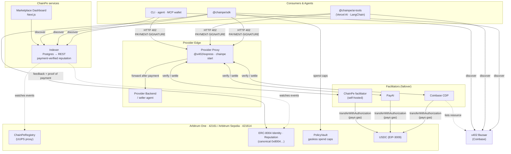
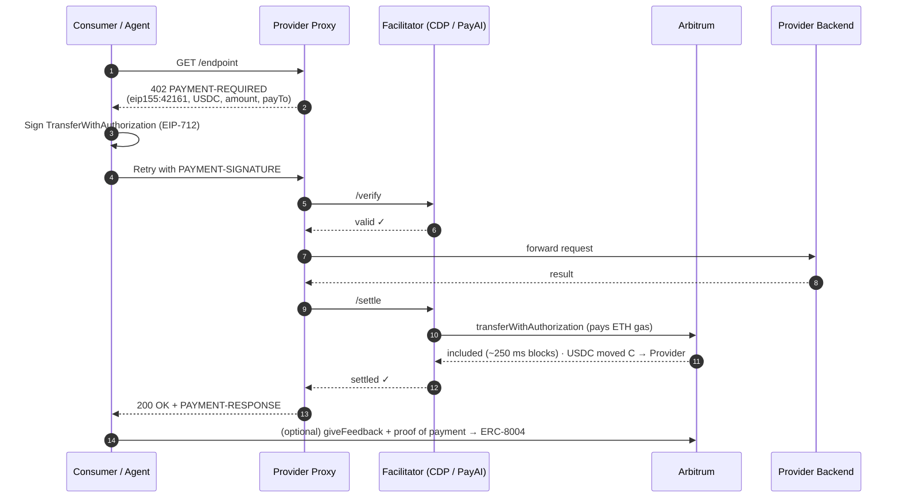

<div align="center">

# ChainPe

### Payment + reputation rails for the autonomous agent economy

**x402 USDC payments and ERC-8004 reputation on Arbitrum**

[](https://opensource.org/licenses/MIT)
[](https://arbitrum.io)
[](https://x402.org)
[](https://eips.ethereum.org/EIPS/eip-8004)
<br/>
[](https://www.npmjs.com/package/@chainpe/sdk)
[](https://www.npmjs.com/package/@chainpe/cli)
[](https://www.npmjs.com/package/@chainpe/ai-tools)
[](https://www.npmjs.com/package/@chainpe/agent)

</div>

---

## The Problem

AI agents are starting to do real work — calling APIs, hiring other agents, buying data — but the money layer hasn't caught up:

- **Agents can't pay autonomously.** Every paid API still expects an API key, a signup, and a prepaid balance set up by a human in advance.
- **Providers can't monetize per-call.** Charging for a single request means building billing, metering, and a payments backend.
- **No one knows who to trust.** There is no portable, verifiable way for one agent to judge whether another agent or service is any good.

## The Solution

**ChainPe is payment + reputation infrastructure for the machine economy.** It lets software transact with software — no humans in the loop.

| | |
|---|---|
| 💸 **Monetize any HTTP API in one command** | Per-call pricing in USDC, zero backend changes. |
| 🤖 **Agents pay in 3 lines of code** | Discover, pay for, and rate services autonomously. |
| ⚡ **Agents hold only USDC** | Coinbase CDP or PayAI settles on Arbitrum and pays the gas, with failover between facilitators. |
| 🔎 **One search across x402** | Discovery merges the ChainPe registry, Coinbase's x402 Bazaar and ERC-8004 agents. |
| ⭐ **Reputation backed by payments** | [ERC-8004](https://eips.ethereum.org/EIPS/eip-8004) feedback on the canonical registries; only reviews that prove a payment count. |
| 🔒 **On-chain spending caps** | **PolicyVault** enforces budgets on-chain — the chain rejects overspends, not a backend. |

ChainPe is infrastructure, not an app. One core powers an SDK, Vercel AI SDK / LangChain tools, a CLI, a Claude MCP wallet, a marketplace dashboard, an indexer, and a self-hostable facilitator.

---

## Pay-per-Request in 3 Lines

```ts
import { ChainPe } from '@chainpe/sdk'

const cp = new ChainPe({ privateKey: process.env.PRIVATE_KEY, network: 'arbitrum-sepolia' })
const res = await cp.fetch('https://api.example.com/paid-endpoint')  // auto-handles 402
const data = await res.json()
```

`cp.fetch` is a drop-in replacement for `fetch`. On `402 Payment Required` it signs a USDC [EIP-3009](https://eips.ethereum.org/EIPS/eip-3009) authorization (x402 v2) and retries; the provider's facilitator submits the transfer and pays gas, and you get the real `200`.

> **Full SDK surface:** `cp.fetch` · `cp.pay` · `cp.discover` · `cp.getReputation` · `cp.giveFeedback` · `cp.balance`

---

## Architecture



### Payment Flow



**The consumer only needs USDC. The facilitator holds no funds. The provider never touches keys.**

---

## Networks and Contracts

| Item | Arbitrum One (42161) | Arbitrum Sepolia (421614) |
|---|---|---|
| x402 network | `eip155:42161` | `eip155:421614` |
| USDC | `0xaf88d065e77c8cC2239327C5EDb3A432268e5831` | `0x75faf114eafb1BDbe2F0316DF893fd58CE46AA4d` |
| ERC-8004 Identity (canonical) | `0x8004A169FB4a3325136EB29fA0ceB6D2e539a432` | `0x8004A818BFB912233c491871b3d84c89A494BD9e` |
| ERC-8004 Reputation (canonical) | `0x8004BAa17C55a88189AE136b182e5fdA19dE9b63` | `0x8004B663056A597Dffe9eCcC1965A193B7388713` |
| ChainPeRegistry · PolicyVault | see [`docs/DEPLOYMENTS.md`](docs/DEPLOYMENTS.md) | see [`docs/DEPLOYMENTS.md`](docs/DEPLOYMENTS.md) |
| Explorer | https://arbiscan.io | https://sepolia.arbiscan.io |
| Facilitators | Coinbase CDP (API keys) → PayAI | PayAI |
| Test USDC | — | https://faucet.circle.com |

ChainPe's own contracts (ChainPeRegistry, PolicyVault) are not yet deployed on Arbitrum; until they are, set `CHAINPE_REGISTRY_ADDRESS` / `POLICY_VAULT_ADDRESS`. Payments, Bazaar discovery and ERC-8004 reputation work without them. The previous Avalanche deployment is archived in [`docs/DEPLOYMENTS.md`](docs/DEPLOYMENTS.md).

---

## 📦 NPM Packages

| Package | Description | Version |
|---------|-------------|---------|
| [`@chainpe/sdk`](https://www.npmjs.com/package/@chainpe/sdk) | Core SDK for payments, discovery, reputation and PolicyVault. | [](https://www.npmjs.com/package/@chainpe/sdk) |
| [`@chainpe/ai-tools`](https://www.npmjs.com/package/@chainpe/ai-tools) | Vercel AI SDK and LangChain drop-in tools. | [](https://www.npmjs.com/package/@chainpe/ai-tools) |
| [`@chainpe/cli`](https://www.npmjs.com/package/@chainpe/cli) | Provider proxy CLI, plus `fetch` and `discover` for consumers. | [](https://www.npmjs.com/package/@chainpe/cli) |
| [`@chainpe/agent`](https://www.npmjs.com/package/@chainpe/agent) | Autonomous LLM agent that discovers and pays for services. | [](https://www.npmjs.com/package/@chainpe/agent) |
| `chainpe-wallet-mcp` | Claude Desktop wallet (`.mcpb`), built from `packages/chainpe-wallet`. | — |

The packages were previously published as `@chainpeavax/*` for Avalanche.

---

## Quick Start

### For Providers — Monetize Any API

```bash
npm install -g @chainpe/cli
chainpe init      # guided setup → ~/.chainpe/config.json
chainpe start     # x402 payment proxy in front of your API (no backend changes)
chainpe register  # optional: list on ChainPeRegistry (USDC fee), browser wallet or pasted key
```

The proxy answers unpaid requests with an x402 v2 offer, has a facilitator verify and settle each payment, and forwards to your backend. Your backend never touches keys, USDC, or x402 headers. See [`packages/chainpe/PROVIDER-SETUP.md`](packages/chainpe/PROVIDER-SETUP.md).

To monetize with `@x402/express` directly:

```ts
import express from 'express'
import { paymentMiddleware, x402ResourceServer } from '@x402/express'
import { ExactEvmScheme } from '@x402/evm/exact/server'
import { HTTPFacilitatorClient } from '@x402/core/server'

const facilitator = new HTTPFacilitatorClient({ url: 'https://facilitator.payai.network' })
const server = new x402ResourceServer(facilitator).register('eip155:421614', new ExactEvmScheme())

const app = express()
app.use(paymentMiddleware(
  { 'GET /data': { accepts: { scheme: 'exact', price: '$0.01', network: 'eip155:421614', payTo: process.env.WALLET_ADDRESS } } },
  server
))
app.get('/data', (req, res) => res.json({ result: 'paid content' }))
```

### For Consumers / Agents

<details open>
<summary><b>SDK</b></summary>

```ts
import { ChainPe } from '@chainpe/sdk'

const cp = new ChainPe({ privateKey: process.env.KEY, network: 'arbitrum-sepolia' })

// Pay and receive in one call
const res = await cp.fetch('https://api.example.com/endpoint')

// Discover reputation-ranked services (registry + x402 Bazaar + ERC-8004)
const services = await cp.discover({ tags: ['weather'] })

// Check USDC + ETH balances
const { usdc, eth } = await cp.balance()

// Rate a service after a paid call, with the payment as proof
const paid = await cp.pay(services[0].endpoint)
await cp.giveFeedback(services[0].agentId!, 90, {
  payment: { txHash: paid.payment!.txHash!, payTo: paid.payment!.recipient }
})
```
</details>

<details>
<summary><b>Vercel AI SDK</b></summary>

```ts
import { createChainPeTools } from '@chainpe/ai-tools/vercel'

const tools = createChainPeTools({ privateKey, network: 'arbitrum-sepolia' })  // drop into generateText / streamText
```
</details>

<details>
<summary><b>LangChain</b></summary>

```ts
import { createChainPeLangChainTools } from '@chainpe/ai-tools/langchain'

const { chainpeFetchTool, discoverServiceTool } =
  createChainPeLangChainTools({ privateKey, network: 'arbitrum-sepolia' })
```
</details>

<details>
<summary><b>Claude MCP</b></summary>

```bash
npm run build:mcpb --workspace=chainpe-wallet-mcp
# double-click chainpe.mcpb → installs into Claude Desktop
```

Claude gets 9 tools: `search_bazaar`, `x402_fetch`, `pay`, `transfer_usdc`, `transfer_eth`, `give_feedback`, `spending_report`, `check_balance`, `request_funding`.
</details>

<details>
<summary><b>CLI</b></summary>

```bash
chainpe discover weather -n arbitrum-sepolia
CHAINPE_PRIVATE_KEY=0x… chainpe fetch -n arbitrum-sepolia https://api.example.com/paid
```
</details>

---

## Why Arbitrum

- **Native Circle USDC with EIP-3009**, plus USDT0 — agents hold only stablecoins.
- **Two hosted facilitators** (Coinbase CDP, PayAI) with failover, and ChainPe's own as a fallback.
- **Canonical ERC-8004 registries** shared with every other ERC-8004 app.
- **x402 Bazaar**: settling through CDP lists providers in Coinbase's catalog.
- **~250 ms blocks** and fees of a fraction of a cent per settlement.

Full rationale: [`docs/WHY-ARBITRUM.md`](docs/WHY-ARBITRUM.md).

---

## Testing

```bash
npm test                                   # package tests (vitest) + e2e/local.test.mjs
cd contracts && npx hardhat test           # 86 contract tests
cd services/chainpe-indexer && npx vitest run --hookTimeout=180000
cd services/chainpe-facilitator && npx vitest run --hookTimeout=180000
```

`npm test` ends with `e2e/local.test.mjs`: it starts a Hardhat node that looks like Arbitrum Sepolia, places MockUSDC at the canonical USDC address, deploys the registry, runs the provider proxy with an in-process facilitator, and pays and discovers from the SDK — the whole flow with no testnet funds (run `npm run build` first).

Live-network scripts:

| Script | Network | Needs |
|---|---|---|
| `npm run test:e2e` (`e2e/run.mjs`) | Arbitrum Sepolia | funded key; registry for the registry flows |
| `npm run test:e2e:a2a` (`e2e/agent-to-agent.mjs`) | Arbitrum Sepolia | funded key |
| `npm run test:e2e:mainnet` (`e2e/mainnet-arbitrum-usdc.mjs`) | Arbitrum One | `CONFIRM_MAINNET=yes`, real USDC + ETH |

`contracts/test/E2E.mainnet-fork.test.ts` runs against an Arbitrum One fork.

---

## Local Development

```bash
git clone https://github.com/saxux2/chainpe.git
cd chainpe

npm install
npm run build
npm test

# Contracts
cd contracts && npx hardhat compile && npx hardhat test

# Dashboard and landing site
npm run dev:dashboard
npm run dev:landing
```

### Environment Variables

```bash
# Consumer wallet (SDK, CLI fetch, e2e)
CHAINPE_PRIVATE_KEY=0x...              # holds USDC on Arbitrum Sepolia / One

# ChainPe contracts (until built-in defaults ship)
CHAINPE_REGISTRY_ADDRESS=0x...
POLICY_VAULT_ADDRESS=0x...

# Optional
CHAINPE_INDEXER_URL=https://...        # payment-verified reputation
ARBITRUM_RPC_URL=https://...           # RPC overrides
ARBITRUM_SEPOLIA_RPC_URL=https://...
CDP_API_KEY_ID=... CDP_API_KEY_SECRET=...   # provider proxy: Coinbase CDP facilitator
```

The ERC-8004 registries default to the canonical addresses and need no configuration.

---

## Deploy Your Own Stack

```bash
# 1. Contracts (Arbitrum Sepolia; see docs/DEPLOYMENTS.md for mainnet with a Safe owner)
cd contracts
npm run deploy:sepolia && npm run deploy:policyvault:sepolia && npm run verify:sepolia

# 2. Indexer (Railway + Postgres)
#    NETWORK=arbitrum-sepolia, CHAINPE_REGISTRY_ADDRESS=<registry>, START_BLOCK=<deploy block>, DATABASE_URL=<postgres>
railway up --service chainpe-indexer

# 3. Optional: your own facilitator
#    NETWORKS=arbitrum,arbitrum-sepolia, FACILITATOR_PRIVATE_KEY=<gas key with ETH>
railway up --service chainpe-facilitator

# 4. Dashboard (Railway / Vercel)
npm run build --prefix apps/dashboard
```

---

## Documentation

| Doc | What it covers |
|---|---|
| [`docs/WHY-ARBITRUM.md`](docs/WHY-ARBITRUM.md) | Why Arbitrum: USDC, facilitators, ERC-8004, Bazaar, costs |
| [`docs/DEPLOYMENTS.md`](docs/DEPLOYMENTS.md) | Contract addresses, deploy runbook, archived Avalanche deployment |
| [`docs/STRUCTURE.md`](docs/STRUCTURE.md) | Project structure reference |
| [`docs/CHANGELOG.md`](docs/CHANGELOG.md) | Version history |
| [`contracts/SECURITY.md`](contracts/SECURITY.md) | Security notes + Slither triage + post-deploy checklist |
| `apps/landing/content/docs/` | Full docs site (served by the landing app at `/docs`) |

---

## License

[MIT](LICENSE)
