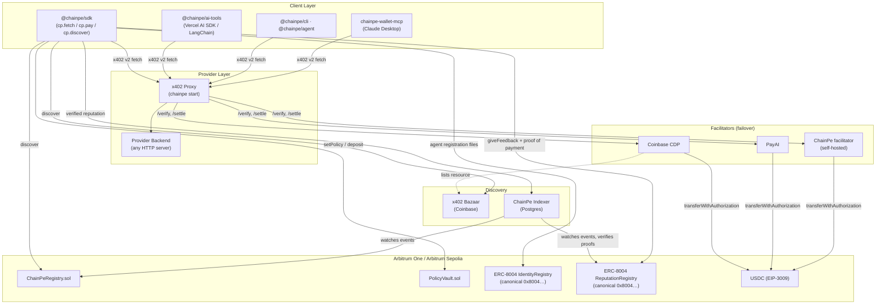
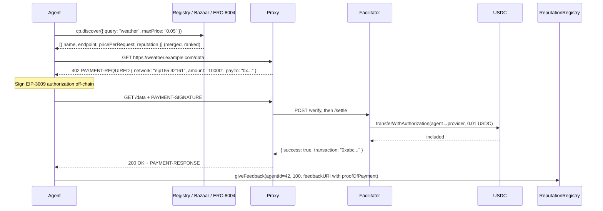

# Architecture Overview

ChainPe is infrastructure, not a single app. One payment + reputation core drives multiple surfaces. This page gives a high-level view of how everything fits together.

## System diagram

## Component responsibilities

### @chainpe/sdk

The primary consumer library. Wraps x402 v2 payments, merged discovery, ERC-8004 reputation and PolicyVault behind a TypeScript API. Its `networks.ts` is the single chain-config table the other packages import.

### @chainpe/ai-tools

Thin adapters that wrap SDK calls as Vercel AI SDK `tool()` objects or LangChain tools. Exposes `chainpeFetch` (pay for and call a URL) and `discoverService` (search and rank services).

### @chainpe/cli

Two roles in one package:
- **Provider**: `chainpe init/start/register` — configure and launch the x402 payment proxy
- **Consumer**: `chainpe fetch <url>` and `chainpe discover` — pay for APIs and search from the terminal

### chainpe-wallet-mcp

An MCP extension for Claude Desktop. Provides 9 tools: `x402_fetch`, `pay`, `search_bazaar`, `check_balance`, `give_feedback`, `spending_report`, `transfer_usdc`, `transfer_eth`, `request_funding`.

### x402 Proxy (chainpe start)

An Express server using the `@x402/express` middleware. Gates every proxied request with a USDC payment and declares x402 Bazaar metadata. Facilitator modes:
1. Hosted, with failover: Coinbase CDP (with API keys) → PayAI on Arbitrum One; PayAI on Arbitrum Sepolia
2. Custom list or URL (`facilitators`, `--facilitator-url`)
3. In-process: `chainpe start --facilitator <key>` settles with a local gas key

Exposes admin endpoints at `/chainpe-admin/stats`, `/chainpe-admin/payments`, `/chainpe-admin/config`, `/chainpe-admin/schema`.

### Facilitator (self-hosted)

`services/chainpe-facilitator` implements the x402 v2 facilitator HTTP contract (`/verify`, `/settle`, `/supported`) for several networks at once. Non-custodial — the key only pays gas and relays the payer's already-signed `transferWithAuthorization`. Rate-limited to 60 req/min per IP. Prometheus metrics at `/metrics`.

### Indexer

Watches `ServiceRegistered`, `ServiceUpdated`, `ServiceDeregistered` from `ChainPeRegistry` and `NewFeedback` / `FeedbackRevoked` from the canonical ReputationRegistry. Verifies each review's proof of payment and stores results in Postgres. Serves a REST API for O(1) discovery and payment-verified reputation.

### On-chain contracts

- `ChainPeRegistry`: the service marketplace. Keyed by `keccak256(developer, name)`.
- ERC-8004 Identity + Reputation: the canonical registries, shared with every ERC-8004 app
- `PolicyVault`: gasless, policy-bounded spending

## Data flow: discovery → payment → reputation

## Trust boundaries

| Boundary | Trust assumption |
|---|---|
| Agent → Facilitator | Agent signs EIP-3009 with exact amount and recipient. The facilitator cannot redirect funds or take more than signed. |
| Facilitator → USDC | Facilitator submits the agent's signed message. The USDC contract verifies the signature independently. |
| Provider → Facilitator | The facilitator could refuse or delay settlement; the proxy fails over to the next one. |
| Agent → Registry | ChainPeRegistry is an upgradeable contract owned by a Safe + timelock on mainnet. Service data is what was registered on-chain. |
| Agent → Bazaar | Coinbase curates the Bazaar; listings are discovery hints, and prices are re-read from each 402. |
| Agent → Indexer | The indexer is an off-chain cache and verifier. Its scores can be re-derived from on-chain data. |
| Owner → PolicyVault | PolicyVault enforces limits on-chain. No backend can override it. |
