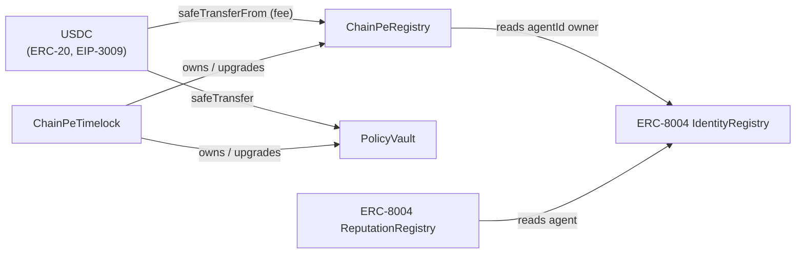

# Smart Contract Architecture

ChainPe's on-chain layer on Arbitrum is two ChainPe-owned contracts (ChainPeRegistry, PolicyVault) plus the canonical ERC-8004 registries and native USDC, which ChainPe uses but does not own.

## Contract groups

### 1. ChainPeRegistry

The service marketplace. Providers register services; agents discover them.

- `ChainPeRegistry.sol` — non-upgradeable version for local dev/reference
- `ChainPeRegistryUpgradeable.sol` — UUPS-upgradeable version for live networks (behind an ERC-1967 proxy)

**Inherits:** `Ownable2Step`, `ReentrancyGuard`, `Pausable`

**Key interactions:**
- Providers call `register(ServiceInput)` — requires USDC fee approval
- Agents call `getServices(offset, limit)` or read via events for discovery
- Owner calls `setRegistrationFee()`, `setUpdateFee()`, `pause()`, `setIdentityRegistry()`

### 2. ERC-8004 registries (canonical)

On Arbitrum, ChainPe uses the canonical singleton registries (`0x8004…`):

- **IdentityRegistry** — ERC-721 token per agent; the token URI points to a registration file
- **ReputationRegistry** — feedback per `agentId` with `value`/`valueDecimals`, tags, endpoint, `feedbackURI` and `feedbackHash`

**Key interactions:**
- Providers call `IdentityRegistry.register(agentURI)` to mint an identity
- Clients call `ReputationRegistry.giveFeedback(agentId, value, valueDecimals, tag1, tag2, endpoint, feedbackURI, feedbackHash)` after paid calls
- Anyone reads `getSummary` / feedback events; ChainPe's indexer verifies payment proofs

The repo vendors the reference implementation in `contracts/contracts/erc8004/` for tests and local Hardhat networks only.

### 3. PolicyVault

Programmable, gasless spending policy.

- `PolicyVault.sol` — non-upgradeable
- `PolicyVaultUpgradeable.sol` — UUPS-upgradeable version for live networks

**Inherits:** `EIP712`, `ReentrancyGuard`, `Ownable`, `Pausable`

**Key interactions:**
- Owners call `deposit()`, `setPolicy()`, `setAllowlist()`, `revokeSession()`
- Agents call `previewSpend()` (view) then sign EIP-712 off-chain
- Relayers call `spend()` with the agent's signature

All time windows use `block.timestamp`: on Arbitrum, `block.number` returns an approximate L1 block number.

### 4. Governance

- `ChainPeTimelock.sol` — timelock that owns the mainnet contracts, with a Safe multisig as proposer

### 5. Mocks (testing only)

- `MockUSDC.sol` — mintable ERC-20 with EIP-3009 for local testing

## Upgrade strategy

Local dev contracts are non-upgradeable for simplicity. Live contracts use the UUPS pattern:

1. Deploy the implementation contract
2. Deploy `ERC1967Proxy(impl, initCalldata)`
3. All interactions go through the proxy address
4. The owner (Safe → timelock on Arbitrum One) can call `upgradeToAndCall(newImpl, data)`

The storage layout is documented in each contract and must not be reordered between upgrades (append-only).

## Contract interaction diagram

## Test coverage

86 Hardhat tests plus an Arbitrum One fork test, covering:

- `ChainPeRegistry`: register/update/deregister, fee collection, pagination, access control, pause/unpause
- `PolicyVault`: per-call cap, daily cap, total budget, expiry, allowlist, session revocation, nonce replay protection, timing
- ERC-8004 (vendored reference): identity minting, reputation feedback, self-feedback blocking
- Upgradeable variants: initialization, UUPS upgrade authorization
