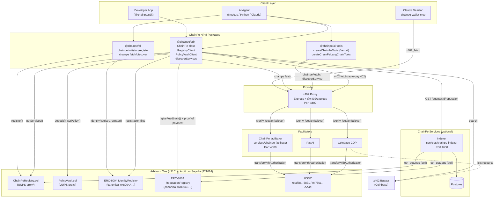

# System Diagram

Detailed component map of the ChainPe system, including data stores, external dependencies, and flow directions.



## Key data paths

### Happy-path payment (no PolicyVault)

```
Agent
  → cp.fetch(url)
  → GET url → 402 PAYMENT-REQUIRED { accepts: [...] }
  → sign EIP-3009 authorization (off-chain, no gas)
  → GET url + PAYMENT-SIGNATURE
  → Proxy: POST /verify to Facilitator (CDP / PayAI, failover)
  → Proxy: forward to Backend → 200
  → Proxy: POST /settle to Facilitator
  → Facilitator: USDC.transferWithAuthorization(agent→provider, amount)
  → Arbitrum: included in the next block (~250 ms)
  → Proxy: 200 + PAYMENT-RESPONSE { transaction: "0x..." }
  → Agent: receives PaidResult with txHash, posts feedback with proof of payment
```

### Happy-path payment (with PolicyVault)

```
Agent (session key)
  → PolicyVaultClient.signSpend(owner, to, amount)
  → returns SpendAuthorization { signature, nonce, deadline }

Relayer (any funded key)
  → PolicyVaultClient.relaySpend(auth)
  → PolicyVault.spend(owner, to, amount, deadline, sig)
  → [on-chain: verify sig, check all caps]
  → USDC.transfer(to, amount)
  → emit Spent(owner, to, amount, relayer, nonce)
```

### Discovery path (SDK)

```
Agent
  → cp.discover({ query: "weather", maxPrice: "0.05" })
  → in parallel:
      ChainPeRegistry.getServices(offset, 100) [paginated, when a registry is set]
      Coinbase Bazaar search (query or tags, up to 20 results)
      ERC-8004 registration files for known agent ids (endpoints probed for their 402 price)
  → de-duplicate by endpoint, filter by query/tags/maxPrice
  → reputation per agent: indexer /agents/:id/reputation (verified) or on-chain summary (unverified)
  → Returns: RankedService[] (scored first, highest score first)
```

### Discovery path (indexer REST)

```
Client
  → GET https://indexer/services?query=weather&maxPrice=0.05
  → Indexer: query over cached service + verified feedback rows
  → Returns: ranked list of services with reputation
```
