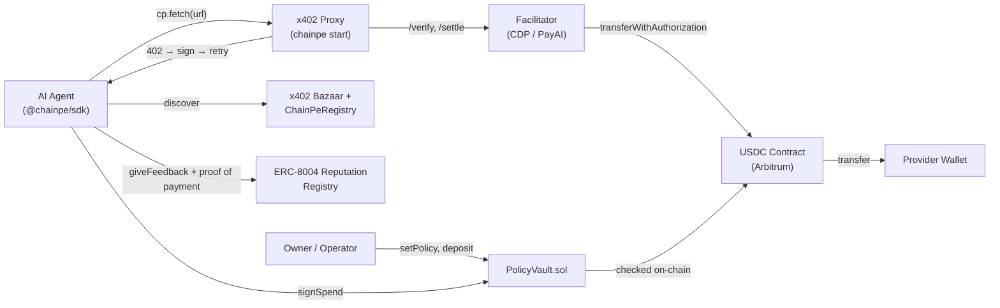

# Concepts

This section explains the core technical concepts behind ChainPe. Understanding these helps you reason about trust, security, and how each component relates to the others.

## x402 Protocol

The HTTP payment protocol ChainPe builds on (version 2). A server returns `402 Payment Required` with structured payment requirements; the client signs a USDC authorization and retries. A facilitator verifies and settles the payment on Arbitrum. [Read more](./x402-protocol.md)

## ERC-8004 Reputation

An Ethereum standard for portable agent identity and reputation. ChainPe uses the canonical ERC-8004 registries on Arbitrum; feedback carries a proof of payment, and ChainPe's indexer counts only reviewers who actually paid. [Read more](./erc-8004-reputation.md)

## Discovery

ChainPe's `discover()` merges three catalogs: the on-chain ChainPeRegistry, Coinbase's x402 Bazaar, and ERC-8004 agent registration files. Results are de-duplicated by endpoint and ranked by reputation.

## Policy Vaults

The `PolicyVault.sol` contract lets owners set per-call caps, daily limits, total budgets, and allowlists for an agent's spending. The agent signs authorizations off-chain (gaslessly); a relayer submits them. The chain enforces every constraint. [Read more](./policy-vaults.md)

## How the concepts connect

