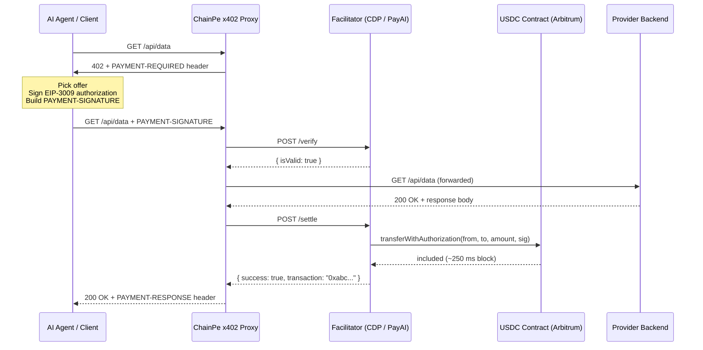

# x402 Protocol

x402 is an extension of HTTP that uses the long-reserved `402 Payment Required` status code to implement machine-native API payments. ChainPe implements x402 version 2 with USDC on Arbitrum One and Arbitrum Sepolia.

## History of HTTP 402

HTTP status code `402 Payment Required` was defined in RFC 2616 (HTTP/1.1, 1999) with the note "reserved for future use." The intent was always to enable per-request payments, but no standard was ever ratified — because the payment infrastructure did not exist. Blockchains and stablecoins changed that.

The x402 specification formalizes how `402` should be used: what the server advertises, what header the client attaches on retry, and how a facilitator verifies and settles the payment on-chain.

## x402 request flow



## Payment requirements (PAYMENT-REQUIRED)

When an x402 endpoint receives a request without payment, it returns `402` with a base64-encoded `PAYMENT-REQUIRED` header. Decoded:

```json
{
  "x402Version": 2,
  "resource": {
    "url": "https://api.example.com/api/data",
    "description": "Weather data per query"
  },
  "accepts": [
    {
      "scheme": "exact",
      "network": "eip155:42161",
      "asset": "0xaf88d065e77c8cC2239327C5EDb3A432268e5831",
      "amount": "10000",
      "payTo": "0xProviderWalletAddress",
      "maxTimeoutSeconds": 300,
      "extra": { "name": "USD Coin", "version": "2", "agentId": "42" }
    }
  ],
  "extensions": { "bazaar": { "...": "discovery metadata" } }
}
```

Key fields:
- `x402Version`: `2`
- `scheme`: `"exact"` means the exact stated amount is transferred; no partial payments
- `network`: a CAIP-2 id — `eip155:42161` (Arbitrum One) or `eip155:421614` (Arbitrum Sepolia)
- `asset`: the token contract (USDC; USDT0 is also possible on Arbitrum One)
- `amount`: the price in atomic units (USDC has 6 decimals; `10000` = 0.01 USDC)
- `payTo`: the wallet address that receives the payment
- `extra.name` / `extra.version`: the token's EIP-712 domain, used to sign
- `extra.agentId`: ChainPe extension — the provider's ERC-8004 agent id
- `extensions.bazaar`: optional discovery metadata for the x402 Bazaar

## Payment header (PAYMENT-SIGNATURE)

The client selects a matching offer, signs a USDC EIP-3009 `transferWithAuthorization`, and retries with a base64-encoded `PAYMENT-SIGNATURE` header. Decoded:

```json
{
  "x402Version": 2,
  "accepted": { "scheme": "exact", "network": "eip155:42161", "...": "the chosen offer" },
  "payload": {
    "signature": "0x...",
    "authorization": {
      "from": "0xAgentWallet",
      "to": "0xProviderWallet",
      "value": "10000",
      "validAfter": "1790000000",
      "validBefore": "1790000300",
      "nonce": "0x...random bytes32..."
    }
  }
}
```

## Payment response header (PAYMENT-RESPONSE)

On successful settlement, the proxy attaches a base64-encoded `PAYMENT-RESPONSE` header. Decoded:

```json
{
  "success": true,
  "transaction": "0xabc123...",
  "network": "eip155:42161",
  "payer": "0xAgentWallet"
}
```

The SDK's `cp.pay()` method decodes this and surfaces it as `result.payment.txHash`.

## ChainPe extensions to x402

### 1. Provider agentId advertisement

Each offer's `extra.agentId` and the `X-CHAINPE-AGENT-ID` response header carry the provider's ERC-8004 `agentId`. Payers use it to post reputation feedback after a paid call without scanning the registry.

### 2. Strict network and token selection

The `ChainPe` client is constructed with a `network` (`'arbitrum'` or `'arbitrum-sepolia'`). It only pays offers on that network, and only in tokens from the SDK's network table (USDC, and USDT0 on Arbitrum One). Anything else is refused rather than guessed.

### 3. Bazaar metadata

When discovery is enabled, the proxy declares the x402 `bazaar` extension (input/output schema, examples, method) on every offer. Coinbase lists the resource in the x402 Bazaar after its first payment settled through CDP.

## How ChainPe implements x402

### Provider side: `@chainpe/cli`

`chainpe start` wraps your backend with Express and the `@x402/express` middleware:

```ts
const resourceServer = new x402ResourceServer(facilitator)       // CDP → PayAI failover
  .register('eip155:42161', new ExactEvmScheme())

app.use(paymentMiddleware(routesConfig, resourceServer))
```

The middleware returns `402` when no `PAYMENT-SIGNATURE` header is present, has the facilitator verify it when one is, forwards to your backend, and settles before returning the response.

### Consumer side: `@chainpe/sdk`

`ChainPe.fetch()` runs the x402 flow with the x402 v2 client: initial request → read `PAYMENT-REQUIRED` → check network, token and `maxPerCall` → sign → retry with `PAYMENT-SIGNATURE` → decode `PAYMENT-RESPONSE`. This gives the SDK full access to the payment metadata for `PaidResult`.

## Supported networks

| x402 network | ChainPe network | USDC address | Facilitators |
|---|---|---|---|
| `eip155:42161` | `arbitrum` | `0xaf88d065e77c8cC2239327C5EDb3A432268e5831` | Coinbase CDP, PayAI |
| `eip155:421614` | `arbitrum-sepolia` | `0x75faf114eafb1BDbe2F0316DF893fd58CE46AA4d` | PayAI |

USDT0 (`0xFd086bC7CD5C481DCC9C85ebE478A1C0b69FCbb9`) is also accepted on Arbitrum One.
